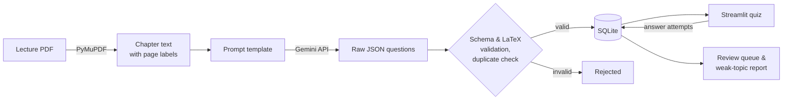

# Study Assistant: LLM-Powered Question Generation & Spaced Review

A personal study tool that turns English lecture slides (PDF) into **exam-style multiple-choice questions** with the **Gemini API**, lets you solve them in a **Streamlit** quiz, and tracks your mistakes to tell you **what to review next** and **which topics are weakest**.

I built it for my Industrial Engineering courses (e.g. *Quality Management*). It supports multiple courses and a small group of users (me and a few classmates).

> The interface and explanations are in Turkish; questions and options are in English, matching the course material.

## Features

- **PDF → chapters:** extracts slide text page by page with PyMuPDF and splits long decks into chapters.
- **LLM question generation:** Gemini writes 4-option MCQs from one chapter at a time. The prompt asks for:
  - scenario-based questions (about half), concept questions, and calculation questions with new numbers, never copied slide examples
  - answers grounded only in the given text, with the **source page** for every question
  - explanations that show the solution steps, with math rendered as LaTeX
- **Validation before saving:** every question is checked against a schema (options A–D, single correct letter, source pages, etc.). Broken JSON and silently corrupted LaTeX (e.g. `\times` turning into a TAB) are rejected. Exact duplicates are blocked, and existing questions are fed back into the prompt to reduce near-duplicates.
- **Quiz (Streamlit + terminal):** pick user → course → PDF → chapter. Every answer is saved *before* feedback is shown (correct answer, explanation, source page).
- **Spaced review rule:** a question comes back if your **latest** answer to it was wrong or you have never answered it. Tracked per user, and the history survives question edits.
- **Weak-topic report:** accuracy per topic for a chapter, a course, or everything, with the 3 weakest topics flagged as "review first".
- **Safe data handling:** content-hash document IDs (renaming a PDF doesn't break anything), transactional and idempotent imports, versioned schema migrations, and verified backups (integrity check plus row counts) to a local folder or iCloud Drive.

## Architecture



### Data model (SQLite)

| Table | Purpose |
|---|---|
| `courses`, `users` | Multiple courses and users |
| `documents` | PDFs, identified by **content hash** and linked to a course |
| `chapters` | Page ranges inside a PDF |
| `generations` | Where questions came from (`llm` with model name, or `import`) |
| `bank_questions` + `question_versions` | Questions with **versioning**; the quiz always uses the latest version |
| `answer_attempts` | Every answer as its own row (user, version, choice, correctness, UTC time) |

Review queues and topic reports are computed directly from `answer_attempts`, so no extra state tables are needed.

## Tech stack

Python 3.13 · Google Gemini API (`google-genai`) · Streamlit · SQLite · PyMuPDF · `unittest`

## Project structure

```
├── app.py                        # Streamlit UI: Quiz and Report tabs
├── core/llm.py                   # Gemini client, retries on 429/503
├── prompts/generate_questions.txt
├── study_tool/
│   ├── extract.py                # PDF → chapter JSON
│   ├── generate.py               # chapter → Gemini → validate → save
│   ├── schema.py                 # question format validation
│   ├── question_bank.py          # JSON bank, atomic writes
│   ├── import_bank.py            # JSON → SQLite (transactional, idempotent)
│   ├── export_bank.py            # SQLite → JSON
│   ├── quiz.py                   # terminal quiz
│   ├── stats.py                  # review rule and weak-topic report
│   ├── manage.py                 # courses, users, PDF ↔ course links
│   ├── storage.py                # DB connection and migrations
│   ├── backup.py                 # verified, timestamped backups
│   └── database_schema.sql
└── tests/                        # 45 unit tests (Gemini is mocked, no API calls)
```

## Getting started

```bash
git clone https://github.com/senasagdc/study_assistant.git
cd study_assistant
python3 -m venv .venv
source .venv/bin/activate
pip install -r requirements.txt
```

Create a `.env` file in the project root with your Gemini API key (free tier works):

```
GEMINI_API_KEY=your_key_here
```

`.env` and `data/` are git-ignored, so slides, questions and the database stay on your machine.

### Typical workflow

```bash
python -m study_tool.manage add-course "Quality Management"
python -m study_tool.manage add-user Sena
python -m study_tool.extract data/QualityManagementWeek5.pdf
python -m study_tool.generate data/QualityManagementWeek5.json 1 5 --course "Quality Management"
streamlit run app.py
```

This creates a course and a user, extracts the PDF into chapters, generates 5 questions for chapter 1 (this step sends the chapter text to Gemini), and opens the quiz at http://localhost:8501.

Other commands:

```bash
python -m study_tool.quiz data/QualityManagementWeek5.pdf 1 --user Sena --due
python -m study_tool.stats --user Sena --course "Quality Management"
python -m study_tool.manage list
python -m study_tool.backup
python -m unittest discover -s tests -v
```

These run the terminal quiz with only due questions, print the weak-topic report, list courses/PDFs/chapters with question counts, take a verified backup to `data/backups/`, and run the test suite.

## Design decisions

- **Validation is about format, not truth.** The schema guarantees well-formed questions, but an LLM can still produce a wrong answer key, especially in calculation questions. Every question keeps its source page so it can be checked against the slides, and versioning lets a question be corrected without losing answer history.
- **SQLite first, hosted later.** A single-file database keeps the tool simple for a few users. Migrations use `PRAGMA user_version` so the schema can evolve without losing data.
- **Answers are recorded before feedback.** Even if the app crashes or the page reloads, no attempt is lost.

## Roadmap

- [x] PDF extraction and chapter splitting
- [x] Gemini question generation with validation
- [x] Terminal quiz, SQLite storage, backups, import/export
- [x] Streamlit quiz, spaced review rule, weak-topic report
- [ ] Upload PDFs and generate questions from the web UI
- [ ] Ask the model to fix invalid JSON automatically
- [ ] Question editing UI (new version per correction)
- [ ] Deployment (Streamlit Cloud + hosted database such as Turso)
- [ ] Embedding-based concept search

## Author

**Sena Sağdıç**, Software Engineering & Industrial Engineering, Bahçeşehir University
[LinkedIn](https://linkedin.com/in/senasagdc) · [GitHub](https://github.com/senasagdc)
